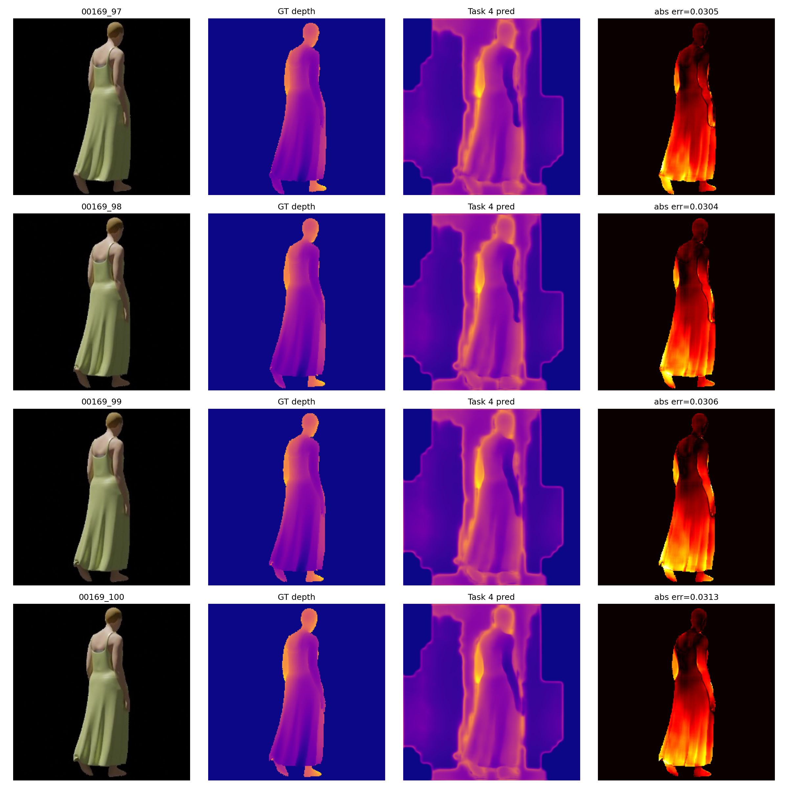

# CLOTH3D++ Depth Estimation

This project estimates body-and-cloth depth from cropped CLOTH3D++ RGB images and studies a UNet baseline, a DeiT transformer, geometry-aware supervision, and final fine-tuning. The experiments are implemented as portable Python modules and task-specific CLI trainers, with notebooks retained as clean research records.



## Highlights

- PyTorch UNet and ImageNet-pretrained DeiT depth models
- SMPL joint projection and multi-task depth/joint supervision
- Reproducible preprocessing, resizing, metrics, checkpoints, and histories

## Requirements

Python 3.10+ is recommended. Install the dependencies with:

```powershell
python -m pip install -r requirements.txt
```

Main dependencies:

- PyTorch, torchvision, timm, torchinfo
- OpenCV, NumPy, SciPy, pandas, matplotlib
- imageio, imageio-ffmpeg, Pillow, trimesh, deodr
- TensorFlow for the legacy baseline notebook

## Data

Place the CLOTH3D++ subset and the bundled SMPL files in the repository root. Then create cropped RGB/depth pairs and split files:

```powershell
python preprocess.py
python resizing.py
```

The trainers expect either `preprocessed_data/` or a resized variant such as `preprocessed_data/resized_variants/256_nearest/`.

## Training

Each stage is an independent, reviewable command:

```powershell
python train_d1.py --root . --epochs 8
python train_d2.py --root . --epochs 8 --decoder bilinear
python train_d3.py --root . --joint-cache runs/d3_losses/joint_cache
python train_d4.py --root . --joint-cache runs/d3_losses/joint_cache --checkpoint runs/d3_losses/checkpoints/last.pt
```

Use `--data`, `--output`, `--batch-size`, `--lr`, and `--img-size` to override defaults. D2-D4 require `timm` and a compatible PyTorch installation; a CUDA GPU is recommended for full experiments.

## Layout

```text
src/data.py              Dataset loading, normalization, and augmentation
src/models/unet.py       D1 UNet baseline
src/models/deit.py       D2 DeiT encoder and decoders
src/models/multitask.py  D3/D4 depth and joint model
src/losses/depth.py      Depth, normal, ranking, and joint losses
src/geometry/            Projection and crop geometry
src/metrics.py           RMSE and surface-normal metrics
src/training.py          Seeds, epoch loop, and checkpoints
train_d1.py ... d4.py    Task-specific experiment entry points
preprocess.py            CLOTH3D++ rendering and crop pipeline
resizing.py              Dataset variant generation
runs/                    Figures, metrics, decisions, and checkpoints
```

The original `depth_estimation_d1-4.ipynb` files remain available for experiment traceability, but their saved outputs and execution counts are intentionally cleared. Dataset files, SMPL assets, and model checkpoints are not redistributed here.
